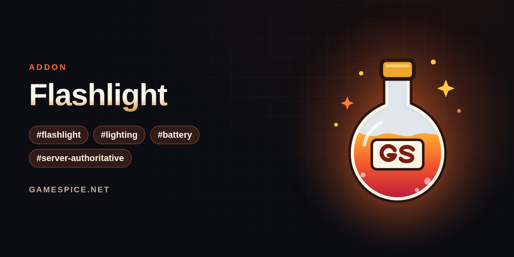

[](https://moddingcommunity.com/a/114-gs-flashlight)

A flashlight the player carries, for Godot 4.7+. It gives you a spot light on the player's eye, a toggle key, an optional battery, state the server owns, and cheap beams for every other player. Part of the [GameSpice](https://github.com/gamespice-platform) family. It needs only [GameSpice Core](https://github.com/gamespice-platform/core).

GameSpice Lighting describes a world's lighting as a document. A flashlight is carried, switched and replicated, so it is a small addon of its own.

## Install

1. Copy `addons/dot_flashlight/` and `addons/dot_core/` into your project.
2. Enable dot-flashlight in *Project > Project Settings > Plugins*.

## Quick start

```gdscript
var fl := GSFlashlight.new()
fl.config = cfg                                  # a GSFlashlightConfig
fl.host = GSNodeRef.of_path(^"Camera")          # the eye; empty means the parent
fl.authoritative = is_server_or_offline
add_child(fl)
fl.begin_map(map_id, ambient_energy, mood)       # allowed here? starts on a dark map?
fl.switch_requested.connect(send_to_server)      # a client only
fl.apply_state(server_state)                     # from the server; fl.state() is what to replicate

var crowd := GSFlashlightCrowd.new()            # everyone else
crowd.config = cfg
add_child(crowd)
crowd.set_viewer(camera.global_position)
crowd.set_lit(key, player.flashlight)
crowd.place(key, player.eye_position(), player.look_direction())
```

## Settings

Every number is a field on `GSFlashlightConfig`. The values below are defaults, and the ranges are inspector slider limits, not enforced caps. Set the property from code or a config file to go beyond them.

| Setting | Default | What it does |
| --- | --- | --- |
| `enabled` | true | Turns the flashlight on or off for the game. |
| `range_m` | 20.0 | Beam range in metres. |
| `angle` | 36.0 | Beam angle in degrees. |
| `energy` | 3.2 | Brightness. |
| `colour` | `#ffedcc` | Beam colour. |
| `shadows` | true | The local beam casts shadows. |
| `shadows_on_web` | false | Allow shadows in a browser or on a phone. |
| `shadow_beams` | 2 | How many of the nearest other beams cast shadows. |
| `remote_beams` | 24 | How many of the nearest other beams are drawn. |
| `remote_range` | 45.0 | How far away another player's beam is still drawn. |
| `remote_energy_scale` | 0.7 | Brightness of other players' beams. |
| `battery` | false | Turns the battery on. |
| `battery_seconds` | 120.0 | How long a full battery lasts. |
| `recharge_seconds` | 60.0 | How long a recharge takes. |
| `key` | `F` | The default key. The input action is `flashlight`. |
| `allowed_maps` | empty | Maps where the flashlight is allowed. |

The config has more fields for the flicker, the restart charge, the dark-map rules and the click sounds. They are in `addons/dot_flashlight/core/dot_flashlight_config.gd`.

Layers, weakest first: the defaults, `cfg/addon/dot_flashlight/*.yml`, the game's files, the operator's files, `DOT_FLASHLIGHT_*` environment variables, then `--flashlight-*` flags. A game that wants cvars binds the config with GameSpice Game's `GSGameConfigBinder` (`profile_kind = "flashlight"`), which exposes every field as a cvar and a profile set.

## Switch sounds

Set `audio` (a `GSNodeRef` to a GameSpice Audio `GSAudioManager`) on both `GSFlashlight` and `GSFlashlightCrowd`. The light then clicks in 3D where it is, and other players' lights click where they stand. The catalogue needs `flashlight_on` and `flashlight_off`. `GSAudioStock.add_to(catalogue)` adds the stock ones, which are synthesised and CC0.

To replace them, add your own defs with those ids before the stock is added (`add_to` skips ids already present), or point `click_on` and `click_off` at other catalogue ids. `click_volume` (0 is silent) and `click_pitch_jitter` tune them. The `clicked(on)` signal is there for a game that plays its own sound. Without `audio`, or with an id the catalogue lacks, the light is silent.

## Cost

Only the local beam and the nearest `shadow_beams` others cast shadows. Only the nearest `remote_beams` inside `remote_range` are drawn. The ranking runs four times a second (`rank_interval` on the crowd).

## Test

```bash
godot --headless --path . --import
godot --headless --path . res://examples/flashlight_selftest.tscn
tools/screenshot.sh out.png      # renders examples/flashlight_demo.tscn
```

The self-test is offline and exits non-zero on any failure.

## Status

Built and maintained with Claude Code. The test suites pass, but little of this has been in front of real players yet. Please report rough edges by opening an issue.

## Licence

MIT. See [LICENSE](LICENSE). Only the TMC back-end web infrastructure is not open source.
